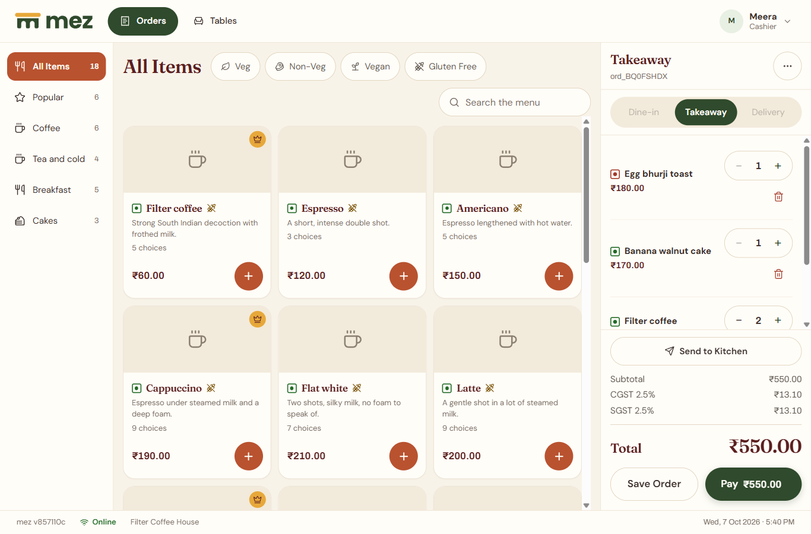

# mez

A point of sale for cafes, bars and small restaurants that runs on the
venue's own computer and keeps selling with no internet. Open source, one
file to install, no subscription.



## In a minute

You run a cafe. Your till should not stop when the broadband does, should
not bill you every month for each tablet, and should not keep your sales on
somebody else's server.

- **It works with the internet off.** mez runs on a computer behind your
  counter. Tills, tablets and kitchen screens talk to it over your own
  network. The internet is not involved in taking an order, sending it to
  the kitchen, taking payment or printing the bill.
- **One file.** On Windows, an installer; a wizard asks your venue's name,
  your tax and a PIN, looks for your receipt printer, and leaves you signed
  in at the till. There is no database to set up and no account to create.
- **Every screen is a browser.** A second till, a waiter's tablet, a
  kitchen display: open the address, type a pairing code. Nothing to
  install on them.
- **One ticket, wherever it starts.** Counter, table or kitchen: the same
  ticket, the same kitchen display, the same invoice series, the same
  night's Z-report.
- **The books are done properly.** Gapless invoice numbers by financial
  year, GST, VAT or sales tax, credit notes for refunds, a blind drawer
  count and a Z-report at close, exports for your accountant.
- **Your data is yours.** It is one folder on your computer. mez copies it,
  as you sell, to a second disk or to cloud storage you choose, and can
  bring the whole venue back from that copy.
- **Guests can order from their table**, by scanning a code with their own
  phone, if you want that. It is the one part that needs the internet, and
  the counter carries on without it.
- **Free, and open.** AGPL-3.0. No fee per till, per month or per sale.

> **Status: alpha, and not yet proven in a cafe.** Everything in the table
> below is built and covered by tests, and most of it has been walked
> through in a browser by its developer. What has **not** happened yet: no receipt has been printed on a
> real printer and no cash drawer opened by one, no release has been
> published (you build it yourself for now), no real payment has gone
> through a gateway, and no venue has run a service on it. Try it beside
> the till you have; do not make it your only one yet.
> [`docs/KNOWN.md`](docs/KNOWN.md) lists what is known to be missing or
> unseen.

## What it does

| Area | Built |
|---|---|
| **Register** | Categories and items, modifiers, quantities, notes, discounts with manager approval, open tickets, hold and resume |
| **Tables** | Floor plan, seat, move, join and part tables, live state across every till |
| **Kitchen** | Kitchen display per station, courses and firing, recall, ESC/POS kitchen tickets |
| **Payment** | Cash, card and UPI, split bills, tips, voids and refunds, credit notes, gapless invoice numbering per financial year |
| **Tax** | GST (India, CGST/SGST), UK VAT, US sales tax, inclusive or exclusive pricing, HSN codes |
| **Printing** | ESC/POS receipts and tickets over TCP:9100, a durable print queue, cash drawer kick |
| **Shifts** | Open and close, blind drawer count, cash in and out, Z-report, tip pooling, Tally and CSV exports |
| **Back office** | Menu editor with photos and sold-out, recipes and stock, staff, roles and permissions, sales reports with heatmap, audit trail, every venue setting, device pairing |
| **Guests** | Ordering from a table's QR code on the guest's own phone, staff accepting each new phone, order tracking, ordering to collect, paying online through Razorpay or Stripe; over an optional relay |
| **Running it** | A Windows installer and service, a setup wizard, a systemd unit, a Docker image, continuous backups to a folder or an S3 bucket, and a restore that was carried out |

Everything runs on the venue's machine. Tills, tablets and kitchen screens are
browsers on the same network. There is no cloud account, no subscription and
no database server to install.

## Quick start

You need a binary. Until releases are published, build one (it takes a
minute, see [Building from source](#building-from-source)):

```sh
make dist        # binaries for Windows, Linux and macOS in dist/
```

Then, on the machine that will run the venue:

```sh
./mez
```

Start `mez` in a terminal. With no venue yet it prints a **setup link**,
`http://localhost:7777/setup#token=...`: open it in a browser **on that
machine** (`mez setup-link` prints it again). The link carries a token kept
in the data directory, so that only someone who may read that directory can
make the venue. It opens the setup wizard: the venue's
name, currency and time zone; tax and invoice numbering; your name and a PIN;
a receipt printer and a test page; and at the end the address and a pairing
code for a second device. It ends with you signed in at the till. The wizard
only works from the machine itself, at `localhost`: from any other device it
says where to go.

The back office is at `http://localhost:7777/backoffice` in the same browser,
on the same pairing; its **Devices** screen pairs every further till and
kitchen display.

**To try it with a demo cafe**, or on a server with no browser of its own
(Docker, a headless box), set the venue up from a terminal instead, before
starting it:

```sh
./mez setup -name "Filter Coffee House" -owner Priya -timezone Asia/Kolkata \
            -device-kind back_office -device-name "Office" -demo-menu
```

`setup` prints the owner's PIN (once, write it down) and a pairing code that
works for ten minutes. `-demo-menu` adds a demo menu, tables and staff with
PINs it prints: never use it for a real venue. `./mez setup -h` lists the
tax, currency and financial year options, and `./mez pair -device-kind
kitchen` makes another pairing code at the machine.

Check a receipt printer before service, with no setup needed:

```sh
./mez --test-print 192.168.1.50
```

[`docs/hardware.md`](docs/hardware.md) says what a printer and a cash
drawer need to be, before you buy one.

## The Windows installer, and the warning Windows shows

`make dist && make installer` builds `mez_<version>_windows_amd64_setup.exe`
(it needs [Inno Setup 6](https://jrsoftware.org/isinfo.php)). Run it on the
venue's PC: it copies mez to `C:\Program Files\mez`, sets it to start with
Windows as a service under its own account, lets tablets on the same network
through the firewall, puts a **mez** shortcut on the desktop that opens the
till in a window of its own (full screen only if you tick that in the
installer) and starts it. Removing it (Settings, Apps) asks whether to keep the venue's
data, and keeps it unless you say otherwise twice.

**The installer is not signed, and Windows will warn you.** When you run it,
a blue box says "Windows protected your PC" and "Microsoft Defender
SmartScreen prevented an unrecognized app from starting", with only a
**Don't run** button in sight. Click **More info**, then **Run anyway**.
Your browser may also say the download "isn't commonly downloaded"; choose
to keep it.

What that warning means: Windows has not seen this file often, and it does
not carry a publisher's certificate. It does not mean Windows found anything
in it. A certificate that removes the warning is bought yearly from a
certificate authority, and this project does not have one. You are being
asked to trust a file from the internet, which is a fair thing to be asked
twice about, so:

- Download it only from this repository's releases page.
- Or build it yourself from the source, which is what the commands above do.

If a certificate is ever in use, the installer and its uninstaller are
signed by the same `make installer` (`MEZ_SIGNTOOL`), and this section will
say so.

## Ways to run it

| How | Status | Guide |
|---|---|---|
| **Windows**, with the installer, as a service | Built and run on a developer's PC; not yet from a published release | [Windows](docs/deploy.md#windows) |
| **Linux**, with systemd, a Raspberry Pi included | Run under systemd in a container; not yet on a machine of its own, and not on arm64 | [Linux](docs/deploy.md#linux) |
| **Docker**, with a volume for the data | Run: `build/Dockerfile` and `build/docker-compose.yml` | [Docker](docs/deploy.md#docker) |
| **On a domain** with HTTPS, behind Caddy or nginx | Works today, with trade-offs to read first | [On a domain](docs/deploy.md#on-a-domain-with-https) |

[`docs/deploy.md`](docs/deploy.md) covers all four, plus guests ordering
from their phones, backups and upgrades.
[`docs/running.md`](docs/running.md) covers every setting and command and
where the data lives. When something does not work,
[`docs/troubleshooting.md`](docs/troubleshooting.md) starts from what the
screen says.

## Building from source

You need Go 1.25 or newer, Node 22.12 or newer, and a shell with `sh` and
`make` (on Windows, Git Bash with GNU Make, or WSL).

```sh
git clone https://github.com/byjoellobo/mez.git
cd mez
make build-web   # format check, tests and production builds of the three apps
make check       # gofmt, go vet, Go tests, TypeScript typecheck, build bin/mez
make dist        # release binaries with the apps embedded, in dist/
```

`make help` lists every target. No cgo, so one machine cross-compiles for
Windows, Linux (amd64 and arm64) and macOS, and two builds of the same
commit are byte-identical.

## How it is built

```
  tills, tablets, kitchen screens (browsers on the LAN)
                 |  HTTP + WebSocket
  +--------------v--------------------------------------+
  |  mez  (one Go binary)                               |
  |  REST API  .  live event hub  .  print queue        |
  |  three embedded web apps: terminal, back office,    |
  |  guest                                              |
  |  SQLite in WAL mode: the single source of truth     |
  +--------------+--------------------------------------+
                 |  TCP 9100
          receipt and kitchen printers, cash drawer
```

A guest's phone, when that is turned on, reaches the same binary through a
relay it dials out to; nothing at the venue is opened to the internet.

Go with the standard library's HTTP server, SQLite through `modernc.org/sqlite`
(pure Go), SQL written by hand and compiled with sqlc, React and TypeScript
with Vite and Tailwind. Orders are an append-only event log; what a screen
shows is a projection of it. Money is always integer minor units.
[`docs/01-architecture.md`](docs/01-architecture.md) has the full picture,
and [CONTRIBUTING.md](CONTRIBUTING.md#how-it-fits-together) follows one
order from a tap to a printed ticket.

## Contributing

Contributions are welcome. Start with [CONTRIBUTING.md](CONTRIBUTING.md): how
to set up, the rules that are never broken, how to test, and how changes are
proposed.

## Documentation

| File | What it covers |
|---|---|
| [`docs/deploy.md`](docs/deploy.md) | Installing on Windows, Linux and Docker, a domain with HTTPS, guests ordering from their phones, backups, upgrades |
| [`docs/running.md`](docs/running.md) | Every setting and command, the data directory, logs, the printer test |
| [`docs/hardware.md`](docs/hardware.md) | What a receipt printer and a cash drawer need to be, and what cannot be used |
| [`docs/troubleshooting.md`](docs/troubleshooting.md) | Printer not found, a tablet that cannot connect, Windows's warning, guest ordering down, a drawer that will not open |
| [`build/relay/README.md`](build/relay/README.md) | Running a relay of your own |
| [`docs/KNOWN.md`](docs/KNOWN.md) | What is broken, left out or not yet seen working |
| [`CONTRIBUTING.md`](CONTRIBUTING.md) | Setting up, how the code fits together, the rules, sending a change |
| [`docs/releasing.md`](docs/releasing.md) | Making a release, for whoever does |
| [`docs/00-product.md`](docs/00-product.md) | Scope and non-goals |
| [`docs/01-architecture.md`](docs/01-architecture.md) | The system and why it is shaped this way |
| [`docs/02-domain.md`](docs/02-domain.md) | Money, orders, invoices and tax |
| [`docs/03-conventions.md`](docs/03-conventions.md) | How code is written here |
| [`docs/DECISIONS.md`](docs/DECISIONS.md) | Every non-obvious decision, as numbered ADRs |
| [`docs/STATE.md`](docs/STATE.md) | Where the build is, and what is next |
| [`docs/phases/`](docs/phases/) | The build plan, phase by phase |
| [`docs/design/`](docs/design/) | Design tokens and screen specs |
| [`web/README.md`](web/README.md) | The three frontends and their dev servers |
| [`CLAUDE.md`](CLAUDE.md) | How an AI agent session works on this repository |

## Licence

mez is licensed under **AGPL-3.0**: the server, the terminal, the back
office, the guest ordering app and the relay. See [LICENSE](LICENSE). If
you run a modified mez for others over a network, you must offer them its
source.

The guest ordering app (`web/guest/`) is under the AGPL like the rest
(ADR-342). It is served by the venue to its guests' phones, and is not
made to be put into other people's pages.
